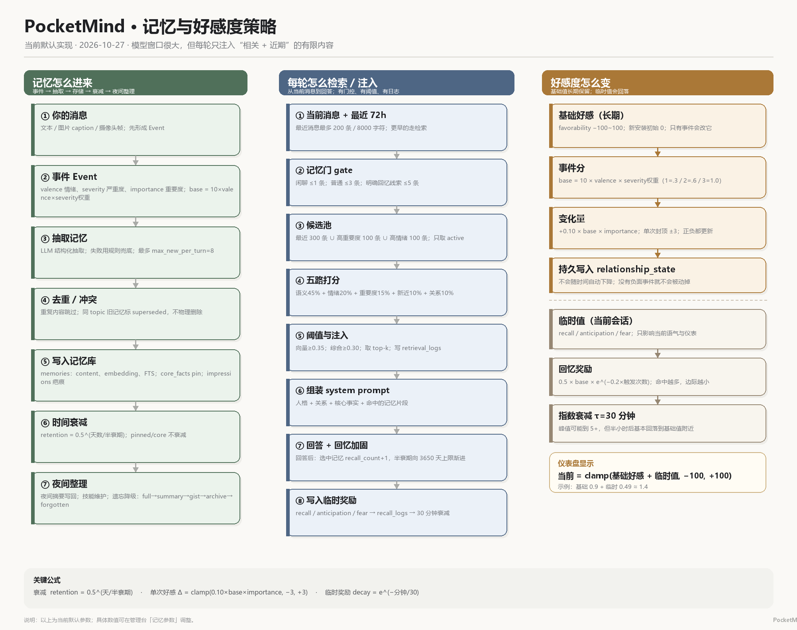
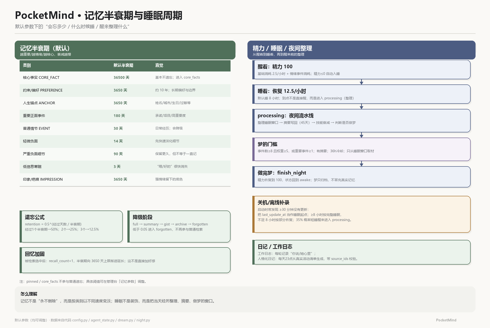

# PocketMind

> 一个运行在你电脑里的“记忆型陪伴 Agent”实验台：她会记住你、慢慢形成关系，也会睡觉、做梦、写日记。
>
> 当前版本：**v0.1.0** · 平台：Windows 10/11 · 默认本地存储、本地运行。

PocketMind 不是把聊天记录塞进大模型窗口的“套壳聊天”。

它把长期记忆、人格、关系、情绪、睡眠和日记拆成一套可观察的机制：

- 聊天只是入口；
- 记忆存进本地数据库，按半衰期自然变淡；
- 每次对话只取“与你当前话题相关”的片段；
- 好感、信任、心境是分开的变量；
- 睡觉时整理当天经历，可能做梦；
- 所有关键数值都可以在管理台看到。



---

## 目录

1. [五分钟开始](#1-五分钟开始)
2. [它是什么、不是什么](#2-它是什么不是什么)
3. [一次对话发生了什么](#3-一次对话发生了什么)
4. [记忆系统：怎么记住、怎么忘记](#4-记忆系统怎么记住怎么忘记)
5. [检索：为什么她只想起一部分](#5-检索为什么她只想起一部分)
6. [好感、信任与心境](#6-好感信任与心境)
7. [睡眠、精力、夜晚与梦](#7-睡眠精力夜晚与梦)
8. [日记、内心话与摄像头](#8-日记内心话与摄像头)
9. [上下文：百万窗口为什么不全部塞满](#9-上下文百万窗口为什么不全部塞满)
10. [什么真正影响她的回复](#10-什么真正影响她的回复)
11. [隐私与安全](#11-隐私与安全)
12. [常见问题](#12-常见问题)
13. [源码地图](#13-源码地图给开发者)
14. [构建、测试与发布](#14-构建测试与发布)
15. [当前限制](#15-当前限制)

---

## 1. 五分钟开始

### 只想用：双击桌面版

从 GitHub **Releases** 下载干净便携包，解压后双击：

```text
PocketMindDesktop\PocketMind.exe
```

特点：

- 不需要 CMD，不需要浏览器；
- 关闭窗口 = 退出（后端一起关闭）；
- 首次启动自动创建自己的数据目录；
- 不包含开发者数据、API Key 或日志。

> 便携包约 **491MB**，因为包含 Electron 运行时；它不进入 git，需放在 GitHub Releases。

### 想改代码：从源码运行

环境：Windows、Python 3.12。

```powershell
uv venv .venv --python 3.12
uv pip install --python .\.venv\Scripts\python.exe -r requirements.txt
.\.venv\Scripts\python.exe -m pocketmind.launcher
```

打开管理台：

```text
http://127.0.0.1:8000/admin
```

没有 API Key 时自动进入 Mock 模式，仍可看到记忆、日记、管理台和评测。

---

## 2. 它是什么、不是什么

### 它是

- 本地优先的长期记忆实验台；
- 人格 / 关系 / 情绪的可观察模拟；
- 可回放的记忆检索与遗忘系统；
- 带睡眠、日记、梦、摄像头输入的陪伴 Agent 原型。

### 它不是

- 不是云服务，不会自动把你的数据同步给别人；
- 不是“模型自己会记住所有聊天”；
- 不是企业级知识库；
- 不是多用户社交产品。

---

## 3. 一次对话发生了什么

```text
你的消息 / 图片 / 摄像头帧
        ↓
形成 Event（情绪、严重度、重要度）
        ↓
抽取长期记忆（LLM；失败时规则兜底）
        ↓
记忆门决定“这轮要不要翻旧账”
        ↓
检索相关记忆 + 取最近 72 小时对话
        ↓
拼装 system prompt
        ↓
调用模型生成回复
        ↓
更新关系、临时奖励、日记、记忆
        ↓
检查记忆衰减 / 夜间安排
```

关键点：

> **模型每轮是独立调用的。**  
> 回答结束后，这一轮的上下文就结束了；下一轮会从本地数据库重新组装。

---

## 4. 记忆系统：怎么记住、怎么忘记



### 4.1 从一句话到一条记忆

每轮用户消息先变成一个 **Event**：

```text
valence    情绪方向：-1（负面）~ +1（正面）
severity   严重度：1 / 2 / 3
importance 重要度：0~1
base_score = 10 × valence × severity权重
```

严重度权重：`1 → 0.3`、`2 → 0.6`、`3 → 1.0`。

然后 LLM 抽取事实/偏好/事件/承诺等，失败时用规则兜底。

写入前会：

- 过滤“嗯/好的/在吗”等噪声；
- Jaccard 相似度去重（默认阈值 0.55）；
- 同主题的新旧说法冲突时，旧记忆标记 `superseded`，不物理删除；
- 每轮最多新增 8 条。

### 4.2 记忆存在哪里

```text
memories      普通长期记忆：content / embedding / 关键词索引 / 半衰期
core_facts    pin 住的核心事实：姓名、城市、生日、过敏、重要约定
impressions   强情绪留下的印象/疤痕
```

核心事实冲突时会保留旧版本（`superseded` / `core_fact_conflicts`），不是直接覆盖历史。

### 4.3 半衰期：为什么有些事会慢慢忘

记忆不是按“条数”删除，而是按**半衰期**变淡：

```text
retention = 0.5 ^ (经过天数 / 半衰期天数)
```

直觉：

```text
经过 1 个半衰期 → 剩 50%
经过 2 个半衰期 → 剩 25%
经过 3 个半衰期 → 剩 12.5%
```

默认半衰期：

| 类别 | 默认半衰期 | 直觉 |
|---|---:|---|
| 核心事实 CORE_FACT | 36500 天 | 基本不遗忘 |
| 约束 / 偏好 PREFERENCE | 3650 天 | 约 10 年 |
| 人生锚点 ANCHOR | 3650 天 | 姓名/城市/生日/过敏 |
| 重要正面事件 | 180 天 | 承诺/项目/高重要度 |
| 普通情节 EVENT | 30 天 | 日常经历 |
| 轻微负面 | 14 天 | 先淡化细节 |
| 严重负面（细节） | 90 天 | 保留更久 |
| 低信息寒暄 | 3 天 | “嗯/好的”很快消失 |
| 印象 / 疤痕 | 3650 天 | 强情绪底色 |

还会根据重要度、情绪强度、独特性和是否为锚点做加成。

### 4.4 遗忘阶段

```text
retention ≥ 0.80           full
0.50 ≤ retention < 0.80   summary
0.20 ≤ retention < 0.50   gist
0.05 ≤ retention < 0.20   archive
retention < 0.05          forgotten
```

- `archive` / `forgotten` 不再参与普通检索；
- `pinned` 核心事实跳过普通遗忘；
- 每次降级都写 `forget_events`，可以回放；
- 系统在**每轮回答后**检查一次记忆衰减，不只在夜间执行。

### 4.5 回忆会加固记忆

被检索选中后：

```text
recall_count += 1
半衰期向 3650 天上限渐进延长
```

所以：

> 越常被正确想起的事，越不容易忘。

这不是直接增加好感，只是改变未来被检索到的概率和半衰期。

---

## 5. 检索：为什么她只想起一部分

### 5.1 记忆门

| 当前输入 | 门控 | 最多注入 |
|---|---|---:|
| 短句/打招呼 | casual | 1 条 |
| 普通陈述 | normal | 3 条 |
| 出现“记得/上次/答应…” | explicit | 5 条 |

闲聊时少翻旧账，明确回忆线索时才深挖。

### 5.2 候选池

只取 `active` 记忆：

```text
最近 300 条
∪ 高重要度/pin 100 条
∪ 高情绪 100 条
```

这样远期重要记忆不会因为“最近窗口”永远进不了候选。

### 5.3 五路打分

```text
最终分 =
  0.45 × 语义相似
+ 0.20 × 情绪匹配
+ 0.15 × 重要度
+ 0.10 × 新近度
+ 0.10 × 关系/功能匹配
```

- 语义：embedding 余弦；
- 关键词：Jaccard + FTS5 兜底；
- 情绪：记忆情绪与当前用户情绪接近程度；
- 新近度：按记忆自己的半衰期计算；
- 关系：记忆功能与当前功能一致=1.0，否则=0.55。

### 5.4 阈值

```text
向量最低 0.35
综合最低 0.30
```

低于阈值不注入；每次检索写 `retrieval_logs`，候选/选中/分数/gate 都可回放。

---

## 6. 好感、信任与心境

策略图见上方。

### 6.1 仪表盘显示的是“基础 + 临时”

```text
当前好感 = clamp(基础好感 + 临时值, -100, +100)
```

### 6.2 基础好感（长期）

字段：`relationship_state.favorability`

- 初始值：**0**
- 范围：-100 ~ +100
- 只有事件能改，**不会随时间自动下降**

```text
单次变化 = clamp(0.10 × 事件分 × 重要度, -3, +3)
```

正面事件上升，负面事件下降；单次最多 ±3。

### 6.3 临时值（当前会话）

来自检索命中的回忆奖励：

```text
回忆奖励 = 0.5 × 记忆base_score × e^(-0.2 × 触发次数)
```

按 30 分钟指数衰减：

```text
剩余 = 原值 × e^(-经过分钟 / 30)
```

所以：

> 峰值 5+ 可能只是临时段叠加；半小时后回到基础值附近是正常现象。

临时值**不写回**基础好感，主要影响仪表盘和“当前氛围”。

### 6.4 信任、亲近、边界、心境

| 字段 | 初始 | 范围 | 当前实现 |
|---|---:|---:|---|
| 信任 trust | 0.5 | 0~1 | 承诺 +0.02；冲突/背叛 −0.04；秘密 +0.01 |
| 亲近 closeness | 0.3 | 0~1 | **当前版本保留字段，暂未自动更新** |
| 边界尊重 | 0.5 | 0~1 | **当前版本保留字段，暂未自动更新** |
| 阶段 stage | acquaintance | — | **当前版本暂未自动推进** |
| 心境 mood | 0 | -1~1 | 每个事件后平滑更新 |

心境更新：

```text
mood = 0.6 × 旧mood + 0.4 × 方向 × 强度
```

关系变化表里的 `event_aftereffect` 就是心境的后效更新，不是新事件。

---

## 7. 睡眠、精力、夜晚与梦

### 7.1 精力

- 初始精力：100；
- 醒着消耗：**2.5/小时**；
- 情绪事件额外消耗：

```text
|valence| × 0.3 × 情绪系数 × max(0.2, min(1, importance))
正面系数 0.8；负面系数 1.2
```

- 精力 ≤ 0 → 自动入睡；
- 睡眠恢复：**12.5/小时**；
- 默认睡 **8 小时**，睡满会进入 `processing`（整理），不是直接醒。

### 7.2 关机 / 离线补录

启动时若发现超过 **30 分钟**没有更新：

- 把 `last_update_at` 当作睡眠起点；
- 若离线 ≥ 8 小时，视为完整睡眠；
- 不足 8 小时，按已睡时长恢复部分精力；
- **35%** 概率短睡醒来进入 `processing`，否则继续睡。

所以“关机后回来，她刚睡醒/已经醒了”不是随机的，而是按离线时间和概率补算的。

### 7.3 夜间流水线

醒来前的 `processing` 会做：

```text
整理睡眠窗口内的事件
→ 生成夜间摘要（可写回为 SUMMARY 记忆，默认半衰期 45 天）
→ 技能衰减/维护
→ 判断是否做梦
→ finish_night：回到 awake，精力 100
```

技能池（skills）是“怎么做”的程序性记忆：可复用流程/约定，和“发生了什么”的事实记忆分开；夜间会衰减，使用时加固。

### 7.4 梦

梦不是真实记忆。触发条件默认：

```text
满足任一：
  · 事件数 ≥ 8 且总权重 ≥ 5
  · 重要事件 ≥ 1
且：有可用于做梦的摘要；距上次梦 ≥ 36 小时
只从睡眠窗口取材
```

梦会记录内容、残留感、来源事件 ID；可以被她自然提起，但不会被当成“真实发生过的事”。

---

## 8. 日记、内心话与摄像头

### 8.1 工作日志

每一轮自动记录：

```text
你说：……
我心里：……
```

这是给开发/回放看的工作日志，不参与检索。

### 8.2 人格化日记

每天约 23 点，从当天**真实活动清单**生成：

- 带 `source_ids` 校验；
- 校验不过就用真实活动兜底；
- 不编造没有来源的经历；
- 写入 `data/diary/persona/YYYY-MM-DD.md`。

### 8.3 内心话

每轮额外生成一句不显示的内心话，只写本地日志，不进入对话、不参与检索。

### 8.4 摄像头

- 手动截取；
- 自动 40 秒观察开关；
- 画面只在用户主动触发时使用；
- 原始 caption 不上屏，只作为模型上下文；
- 评论只进主对话；
- 权限只允许本地 `127.0.0.1` 页面申请。

---

## 9. 上下文：百万窗口为什么不全部塞满

每轮请求包含：

```text
system prompt（人格/关系/核心事实/检索记忆）
+ 最近 72 小时消息（最多 200 条、8000 字符）
+ 当前消息
```

默认预算：

| 项目 | 默认 |
|---|---:|
| 系统注入 | 4000 字符 |
| 最近消息 | 200 条 |
| 最近消息字符 | 8000 |
| 时间窗 | 72 小时 |

原因：

- 模型窗口是“单次上限”，不是长期记忆；
- 全部塞满会增加成本、延迟，并稀释注意力；
- 近 3 天完整消息保证连续性；
- 更早内容靠检索记忆和核心事实。

> 每轮都是独立请求；回答结束，本轮上下文结束。数据库和记忆不会重置。

---

## 10. 什么真正影响她的回复

直接进入 system prompt / messages 的：

- 人格卡、说话方式、边界；
- 关系快照：基础好感、信任、亲近、边界、心境；
- 当前对用户的情绪推断（例如“对方看起来难过”）；
- 核心事实；
- 检索到的记忆片段；
- 最近 72 小时消息；
- 当前消息 / 图片 caption。

**不直接进入 prompt**：

- 仪表盘上的临时值（recall / anticipation / fear）目前只用于展示和日志；
- 它不会以数字形式告诉模型“现在好感 +3”。

间接影响：

- 回忆奖励让记忆以后更易被检索；
- 关系更新会改变下一轮的关系快照；
- 心境更新会改变下一轮的语气。

所以：

> **基础关系、心境和当前情绪会影响输出；临时奖励数字本身目前不会直接进入 prompt。**

---

## 11. 隐私与安全

### 数据在哪

```text
%APPDATA%\PocketMind\data
```

包含：SQLite 数据库、日记、媒体、设置、加密后的 Key。

### API Key

- 不写明文 `settings.json`；
- AES-256-GCM（随机 12 字节 IV + 128-bit tag）；
- 主密钥由 Windows DPAPI 保护，绑定当前 Windows 用户；
- 换 Windows 用户/电脑后无法解密，需要重新填写。

文件：

```text
data/secrets/master.key.dpapi
data/secrets/api_keys.enc
```

### 发布哈希

构建生成 `release_manifest.json`：

- git commit；
- 源码树 SHA-256；
- 后端 exe / 桌面 exe / main.js 哈希；
- 签名状态。

管理台「总览 → 安全与完整性」可查看。

> 当前**没有代码签名**。哈希能发现文件被替换，但不能证明发布者身份。

### 这个仓库里有什么

- 只有源码、构建脚本、README/图片；
- 没有用户数据、记忆、日记、媒体、API Key、日志、备份；
- 安装包在 Releases，不在 git。

---

## 12. 常见问题

### 为什么好感峰值很高，后来变低了？

因为仪表盘显示“基础 + 临时”。临时值 30 分钟衰减，基础值没掉。

### 为什么基础好感涨得慢？

只有被识别为“关系事件”的输入才会改基础值；普通闲聊可能不触发。基础值不会因时间自动上涨。

### 为什么有些记忆会想不起来？

按半衰期变淡，降到 `archive/forgotten` 后不再参与普通检索。重要/核心内容会 pin 或半衰期更长。

### 新安装的好感是 0 吗？

干净新数据库：基础好感 0；信任 0.5、亲近 0.3、边界 0.5、心境 0。复制旧 data 则继承旧值。

### 换电脑/重装怎么迁移？

备份整个 `%APPDATA%\PocketMind\data`；但 `secrets/` 绑定 Windows 用户，到新机器需要重新填 API Key。

### 为什么模型上下文很大，却不把历史全塞进去？

模型窗口不是长期记忆；全量重放成本高、延迟高、注意力被稀释。PocketMind 用“近期窗口 + 检索 + 结构记忆”代替无限历史。

### 临时奖励会影响她怎么说话吗？

目前不直接进入 prompt；它只影响仪表盘。真正进入 prompt 的是关系快照、心境和当前情绪推断。

---

## 13. 源码地图（给开发者）

| 文件 | 作用 |
|---|---|
| `pocketmind/pipeline.py` | 一轮对话的总编排：事件→检索→回复→关系→记忆→日记 |
| `pocketmind/memory.py` | 记忆抽取、写入、核心事实、印象、衰减/遗忘 |
| `pocketmind/retrieval.py` | 记忆门、候选池、五路打分、检索日志 |
| `pocketmind/scoring.py` | 情绪/严重度/重要度、半衰期、关系、奖励公式 |
| `pocketmind/prompts.py` | system prompt 渲染与预算 |
| `pocketmind/persona.py` | 人格卡与关系持久化 |
| `pocketmind/transient.py` | 临时奖励/衰减（当前主要展示） |
| `pocketmind/agent_state.py` | 精力、睡眠、离线补录、强制唤醒 |
| `pocketmind/night.py` | 夜间整理流水线 |
| `pocketmind/dream.py` | 夜摘要、梦的门槛与生成 |
| `pocketmind/diary.py` / `persona_diary.py` | 工作日志 / 人格化日记 |
| `pocketmind/media.py` | 图片/摄像头媒体 |
| `pocketmind/skill.py` | 程序性技能池与衰减 |
| `pocketmind/extraction.py` | 结构化提取提示词与解析、Mock 兜底 |
| `pocketmind/config.py` | 全部默认参数（半衰期/预算/睡眠/梦） |
| `pocketmind/db.py` | SQLite schema、迁移、FTS |
| `pocketmind/models.py` | Event / Memory / Relationship 等数据模型 |
| `pocketmind/prompt_store.py` | Prompt 模板读取/保存/恢复 |
| `pocketmind/admin.py` / `admin_schema.py` | 管理台 API、参数说明、数据浏览 |
| `pocketmind/visualizer.py` | 记忆星图 PCA 投影 |
| `pocketmind/backup.py` | 备份/恢复 |
| `pocketmind/evaluation.py` / `simulator.py` | 召回评测 / 3 天模拟 |
| `pocketmind/launcher.py` / `cli.py` | 端口/启动/桌面模式 / 命令行 |
| `pocketmind/tts.py` | TTS 接口占位（当前未接入主流程） |
| `pocketmind/secrets_store.py` | AES-256-GCM + DPAPI |
| `pocketmind/settings_store.py` | settings.json 读写 |
| `pocketmind/release_security.py` | 源码/构建哈希与校验 |
| `pocketmind/web.py` | FastAPI 路由、页面、管理台 API |
| `desktop/` | Electron 壳、构建/安装/更新脚本 |

---

## 14. 构建、测试与发布

### 桌面版构建

```powershell
cd desktop
npm install
cd ..
.\desktop\build_portable.ps1 -ElectronRoot "desktop\node_modules\electron\dist"
```

需要 Electron 运行时；仓库不包含 Electron 二进制。

安装到本机：

```powershell
.\desktop\install_portable.ps1
```

默认构建**不包含任何用户数据**；`-SeedData` 仅用于个人迁移。

### 测试

```powershell
.\.venv\Scripts\python.exe -m pytest -q
.\.venv\Scripts\python.exe -m ruff check pocketmind tests
```

当前：**111 项测试通过**。

### 发布到 GitHub

1. 新建空仓库；
2. 提交源码、README、图片；不要提交 `installer/PocketMindDesktop/`、`data/`、`secrets/`、日志、备份；
3. 将干净便携包压缩后上传到 **Releases**；
4. 在 Release 说明中附上 `SHA256SUMS.txt`。

> 安装包约 491MB，超过 GitHub 单文件 100MB 限制，所以不进入 git。

---

## 15. 当前限制

- Windows 专属（DPAPI + Electron 桌面壳）；
- 安装包约 491MB；
- 未做代码签名，Windows 可能提示未知发布者；
- 模型/Embedding 需要用户自己配置 API Key；
- 关系/记忆参数是可调启发式，不是心理科学定论；
- 临时奖励目前主要影响仪表盘，未直接注入回复；
- 尚未附带开源许可证，发布前需自行选择 `LICENSE`。

---

## 版本

- 版本：v0.1.0
- 更新：2026-10-27
- 代码提交与哈希：见 `release_manifest.json`
